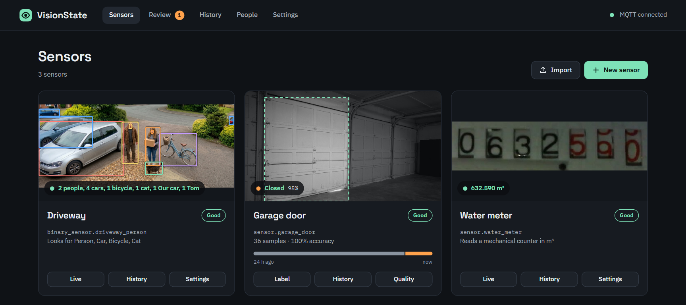
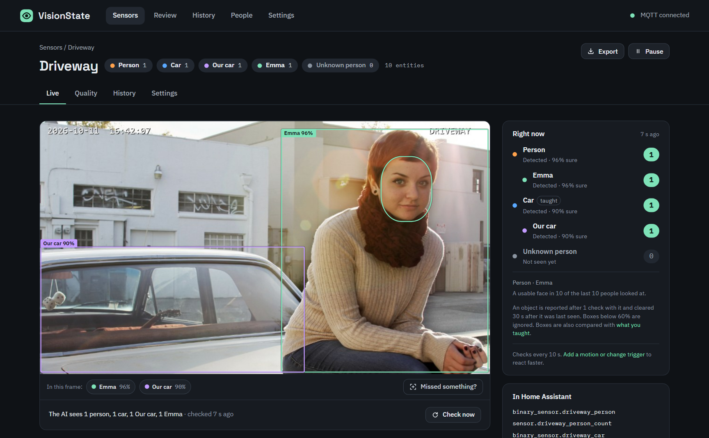
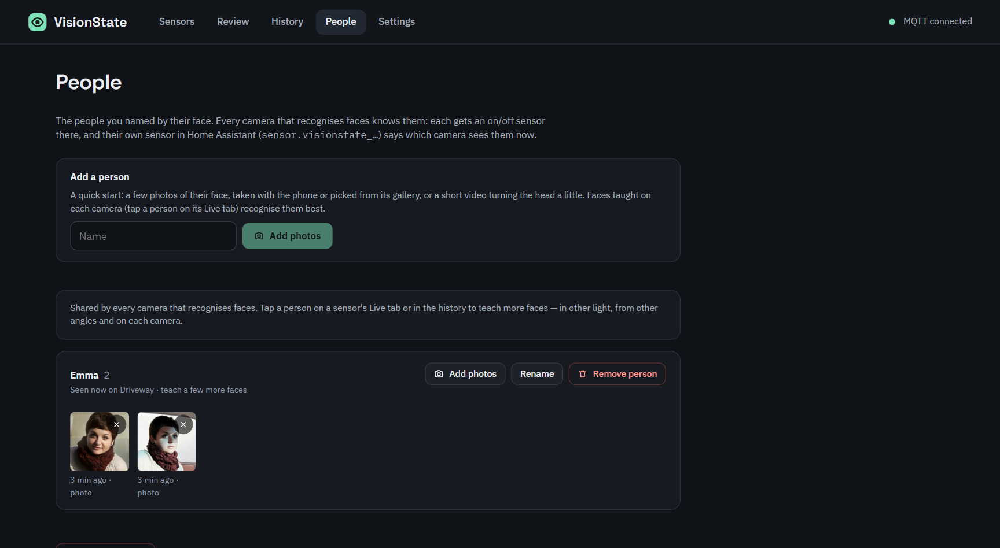
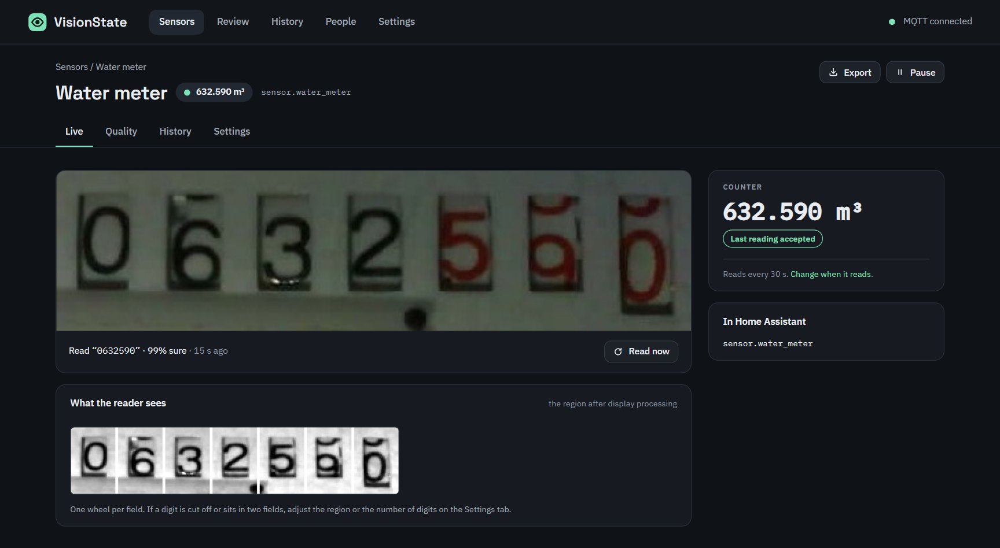
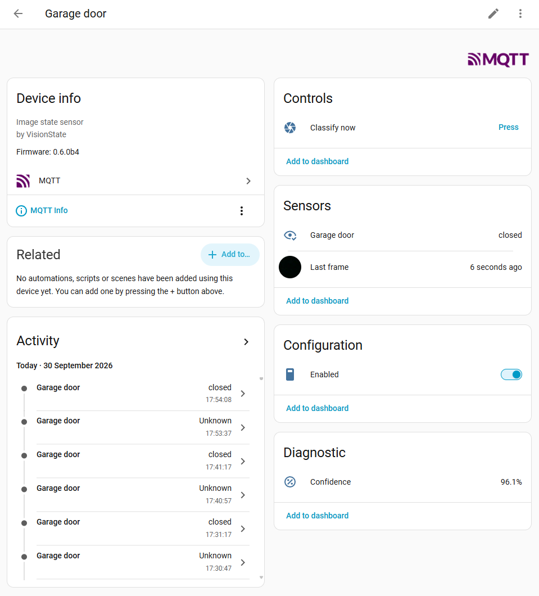
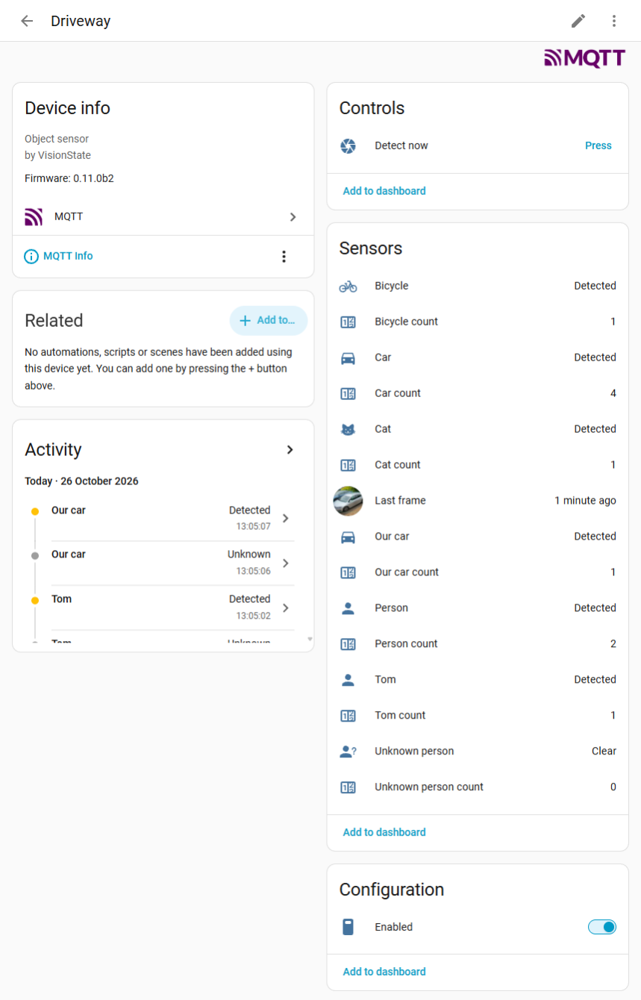

<p align="center">
  <picture>
    <source media="(prefers-color-scheme: dark)" srcset="docs/promo/logo-dark.png">
    
  </picture>
</p>

<p align="center">
  <b>Turn your cameras into Home Assistant sensors — with a local AI you teach in minutes.</b><br>
  Is the garage door open? Who just came home, and is that our car? What does the water meter say?
</p>

<p align="center">
  <a href="https://github.com/oleost/VisionState/actions/workflows/ci.yml"></a>
  
  
  
  <a href="LICENSE"></a>
  <a href="https://buymeacoffee.com/o1ep"></a>
</p>

<p align="center">
  <a href="https://my.home-assistant.io/redirect/supervisor_add_addon_repository/?repository_url=https%3A%2F%2Fgithub.com%2Foleost%2FVisionState">
    
  </a>
</p>

<p align="center">
  
</p>

## Three kinds of sensor

### 🚪 States

*Garage door open, closed or halfway*, the gate shut, the lights on in the shed.

Click a few examples of each state; it learns in about a second.

### 🧍 Objects & people

*Tom is home*, *our car is in the driveway*, a cat and a bicycle on it, an unknown person at the door.

Pick from 80 objects — no training. Name people by their face once; every camera knows them.

<p align="center">
  <br>
  <em>Tom recognised by his face, and our own car told apart from any other car.</em>
</p>

<p align="center">
  <br>
  <em>A few photos from your phone are enough to start; faces never leave your Home Assistant.</em>
</p>

### 🔢 Readings

*The water, gas or power meter*, the minutes left on the washer.

Draw a box around the number. Counters only go up and land in the Energy dashboard.

## Read a water, gas or power meter with an ESP32-CAM

Put an ESP32-CAM (or any camera) above the meter, add it to Home Assistant with ESPHome or use its
snapshot URL, and draw a box around the digits — a camera that cannot hang straight sees the
meter turned or at an angle: put the box's corners on it, and it is read upright. VisionState reads the rolling wheels of a
mechanical water or gas meter and the digits of an LCD or LED power meter, checks every value
before it is published (a counter never goes down or jumps), and the total lands in the Energy
dashboard — with a rate (m³/h, kW) if you want one. For a dark meter cabinet it switches a light
on for each reading; a battery camera can trigger a check when it has a new picture.

<p align="center">
  <br>
  <em>The rolling wheels of a real water meter, read right even while a wheel is half way between two digits.</em>
</p>

## Highlights

- 🧠 **100 % local on any CPU** — Intel, AMD, Raspberry Pi 4/5. No cloud, no GPU, no subscription, no telemetry.
- 🏠 **Native Home Assistant** — a sidebar app; every sensor is a normal device through MQTT discovery.
- 🎥 **Any camera** — every `camera.*` entity (an ESP32-CAM with ESPHome, Reolink, Frigate …), or an RTSP / HTTP snapshot URL.
- 🎯 **Watch only what matters** — draw a region around the door or the driveway; the rest is ignored.
- ⚡ **Checks when something happens** — on motion, a door contact or a change in the image, and can switch on a light for a camera in the dark.
- 🔁 **Gets better as you use it** — unsure frames go to a review queue, wrong boxes are fixed with a tap, and suspicious labels are flagged.

## In Home Assistant

<p align="center">
  
  
</p>

- **State sensor** — the state with its confidence, the last frame, a button to check now and a switch to pause it.
- **Object sensor** — an on/off sensor and a count for every object, person and own label.

Use them like any other sensor — for example, tell me when the garage door has been open for
10 minutes:

```yaml
triggers:
  - trigger: state
    entity_id: sensor.garage_door
    to: open
    for: "00:10:00"
actions:
  - action: notify.notify
    data:
      message: Garage door open!
```

## Install

**Requirements:** Home Assistant OS or Supervised (2025.10 or newer), the **Mosquitto broker** app
with the **MQTT** integration, and a camera.

1. Click **Add repository** above — or add `https://github.com/oleost/VisionState` under
   **Settings → Apps → App store → ⋮ → Repositories**.
2. Install **VisionState**, start it and open it from the sidebar.
3. **New sensor** → pick a camera, draw a region, choose what to watch. The wizard tests it on a
   fresh frame right away.

New features come to a separate **beta** app first: add `https://github.com/oleost/VisionState#beta`
instead. Run only one of the two at a time (they publish the same sensors); move everything with
**Settings → Backup**, or single sensors with **Export** and **Import**.

The user guide — every entity, triggers, faces, readings, review — is on the app's
*Documentation* tab ([`visionstate/DOCS.md`](visionstate/DOCS.md)).

## How it works

```
camera
 ▼  your region
 ▼  pretrained model (ONNX, CPU)
 ▼  small per-sensor model
 ▼  debounce
 ▼  MQTT
Home Assistant
```

- **States:** [DINOv2](https://github.com/facebookresearch/dinov2) turns the region into a feature
  vector; a tiny classifier per sensor, trained on *your* examples, picks the state.
- **Objects:** [D-FINE](https://github.com/Peterande/D-FINE) finds the COCO objects; boxes you
  corrected or gave an own label teach it your camera.
- **Faces:** [YuNet](https://github.com/opencv/opencv_zoo) finds a face on each person, and only a
  clear one is compared ([SFace](https://github.com/opencv/opencv_zoo), or
  [AuraFace](https://huggingface.co/fal/AuraFace-v1) on a fast PC) with the faces you named.
- **Readings:** [PaddleOCR](https://github.com/PaddlePaddle/PaddleOCR) reads digits; mechanical
  counters use a small wheel reader made for VisionState ([`tools/wheelreader`](tools/wheelreader)).
  Every value is checked before it is published.

## Privacy & security

- Nothing leaves your machine; there is no telemetry.
- Only reachable through Home Assistant Ingress (a Home Assistant login).
- Camera passwords are hidden in logs and removed from exports; a backup holds them only if you
  tick it.
- Face recognition is off until you turn it on for a camera; faces are kept in the app's own
  storage and exported only if you tick it (a backup holds them unless you untick it).

## Contributing

Pull requests go to the `beta` branch. [`CLAUDE.md`](CLAUDE.md) is the contributor guide (run it
locally against a fake camera, checks, UI tests on desktop and phones) and
[`docs/ARCHITECTURE.md`](docs/ARCHITECTURE.md) maps the code. Issues and ideas:
[GitHub Issues](https://github.com/oleost/VisionState/issues). Security: [`SECURITY.md`](SECURITY.md).

## Licence

[Apache-2.0](LICENSE). Bundled models: DINOv2 (Meta), D-FINE, PaddleOCR PP-OCRv6 and the
VisionState wheel reader, all Apache-2.0. Face models, downloaded only when a camera recognises
faces: YuNet (MIT), SFace or AuraFace (Apache-2.0). The screenshots use CC0 and public-domain
images.

If VisionState is useful to you, you can [buy me a coffee](https://buymeacoffee.com/o1ep) ☕
