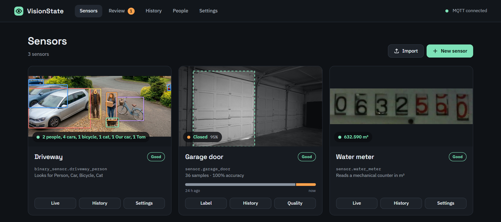

# VisionState



Teach a local AI to recognise **states** in camera images — a garage door that is `open`,
`closed` or `partial`, a gate, a parking spot, a light — and use the result as a normal
Home Assistant sensor. Or let it find **objects** — people, cars, animals and more — **read a
number** from a display, or **listen** for sounds — sirens, a smoke alarm, a dog, a doorbell
— without any training, and learn your own sounds from a few clips. Everything runs on this machine; no cloud.

## Requirements

- **Home Assistant 2025.10 or newer.**
- **MQTT**: VisionState publishes its sensors through MQTT discovery. Install the
  **Mosquitto broker** app and the **MQTT** integration if you do not have them yet.
  VisionState finds the broker automatically.
- **A camera** in Home Assistant (any `camera.*` entity: Frigate, ESP32-CAM, Reolink,
  generic camera…), or a direct HTTP snapshot URL (`http://` or `https://`) or stream URL
  (`rtsp://`, `rtsps://`, also an `http://` video stream). A stream is kept open while frames
  are asked for often (a burst of checks, the live view), so those come at once instead of after
  a new connection each time.
  A sound sensor needs a stream with sound: a camera's stream with its microphone on, or an HTTP
  audio stream (an ESP32 microphone).
- amd64 (Intel/AMD) or aarch64 (Raspberry Pi 4/5, 64-bit OS). Any 64-bit Intel/AMD CPU works,
  also in a virtual machine with a generic CPU type (for example Proxmox's `kvm64`).

## Getting started

1. Open **VisionState** from the sidebar.
2. Click **New sensor** and choose **Watch the picture** (the steps below) or **Listen** (a sound
   sensor: see *Sound sensors* below):
   1. Give it a name and pick a camera — and, for a camera in a dark place, a light to switch on
      (see *A light for the camera* below). A small picture from the camera shows what you picked.
      A small one gets a warning: it may be the camera's low-resolution stream, and its main stream
      is often hidden in Home Assistant.
   2. Choose what it detects: **States** (name them, for example *Open*, *Closed*, *Partial*),
      **Objects** (see *Object sensors* below) or **Reading** (see *Reading sensors* below).
      This can not be changed later. In the same step, draw a box around the thing to watch (for
      example the garage door). The AI only looks inside the box, which makes it far more accurate.
      For an object that sits at an angle, shape the box: drag a corner to move it, drag a **+** on
      an edge to add a corner, and double-click / double-tap (or press and hold) a corner to remove
      it. Everything outside the shape is ignored. **Reset to rectangle** goes back to a plain box.
   3. Optionally choose when it should check the camera — for example when your motion
      sensor or garage opener changes (see *When it checks* below) — and whether it should stay
      out of Home Assistant for now (see *What a sensor has in Home Assistant* below). You can skip
      this step.
3. On the **Label** tab, click or tap the matching state button (or press `1`–`9`) while the live
   image shows each state. The model retrains in about a second after every label.
4. Label roughly **20 images per state**, including some at night. The **Quality** tab tells
   you what is missing.

**A sensor's page** has a few tabs: what it sees now (**Live**, or **Label** for a state sensor),
**History**, **Dataset** (what it was taught: a state sensor's images and uploads, an object
sensor's taught boxes, a sound sensor's own sounds) and **Quality** (how well it does: state and
reading sensors). **Settings**, beside **Pause** at the top, is in sections: *General* (name, camera,
light), *Region*, what it looks for (*States*, *Objects*, *Region and reading* or *Listening*),
*Checks and output* (or *Review* for a sound sensor), *Home Assistant*, and *Export or delete*. On a
phone they are a list, each saying what is set; tap one to open it. A change waits for **Save
changes** at the bottom of the screen, and is kept while you look at another section (**Undo**
puts back what is saved). A tab that does not fit on a very narrow screen is under **More**.

The sensor appears in Home Assistant as a device named after the sensor, with these entities
(Home Assistant names them after the device, like other integrations):

| Entity | What it is |
|---|---|
| `sensor.<name>` | The state (`open`, `closed`, …, or `unknown` when unsure) |
| `sensor.<name>_confidence` | How sure the AI is, in whole % |
| `image.<name>_last_frame` | The image region that was classified — sent when the state changes, otherwise every few minutes |
| `button.<name>_classify_now` | Classify right now (use it in automations) |
| `switch.<name>_enabled` | Pause / resume the sensor |

If an ID is already taken, Home Assistant adds `_2`. You can change any of them in Home
Assistant (the entity's settings → *Entity ID*); VisionState shows the IDs Home Assistant uses.
Sensors made before 0.6.3b6 keep the IDs they have (`sensor.visionstate_<name>`, …), also
when exported and imported — nothing changes for them.

In addition, the **VisionState** device has `sensor.visionstate_review_queue`: the number of
frames waiting for review, with a per-sensor breakdown and `oldest_waiting_since` (when the
oldest of them came) as attributes.

The state entity also has a `probabilities` attribute with the score of every state (in whole
percent, as a fraction) and a `last_trigger` attribute telling what caused the last check.

Nothing VisionState sends changes at every check unless the result does: Home Assistant stores
each new state in its database, so values that only move a little (a timestamp, a confidence to
the decimal, the same picture again) would fill it. The pictures, and an object's boxes, follow
the result at once and are otherwise sent again every few minutes.

**What a sensor has in Home Assistant** is set under its **Settings → Home Assistant**:

- **Send values:** its entities exist and follow what the sensor finds.
- **Don't send values:** the sensor runs as usual — its
  history, Quality tab and review queue fill up — but its entities stay *unavailable*: no values, so
  no statistics either. Useful for tuning a sensor, for example one that takes over the entity ID of
  an older one, so wrong readings do not end up in its statistics. The pause switch and the
  check-now button (a sound sensor has none) keep working.
- **Not in Home Assistant** (also in the last step of the wizard, to set a sensor up first): no
  entities at all and nothing on MQTT; the sensor is used in VisionState only.

Below that you tick which entities it has: on an object sensor *Detected*, *Count* and *Snapshot* for
each object, on a sound sensor each sound, and on the other sensors the optional ones such as *Last
frame*. What is ticked is there and
switched on in Home Assistant (one that was off there comes on within about a minute). What you
untick is removed from Home Assistant, and automations using it stop working; tick it again and it
comes back with the entity ID and name it had. Removing needs MQTT to be connected: otherwise
nothing is saved and you are told why.
Sensors not sent, or not in Home Assistant, are marked on the dashboard.

A sensor made before this choice existed keeps what it has in use: after the update, the optional
entities of a reading sensor (raw reading, problem, accepted, rate, reader image) that are on in Home
Assistant stay, and those that are off there are removed. Those removed can take a while to leave
Home Assistant's lists. From then on the choice decides.

## Object sensors

An object sensor finds common objects — people, cars, bicycles, cats, dogs, birds and 74 more —
with a pretrained detector. There is nothing to label: pick the objects in the wizard (popular
ones first, all others under **Show all**) and the wizard tests it on a fresh frame right away.
Where it gets your camera wrong, you can correct it later (see *Teaching an object sensor*).

- **The region** decides what counts: an object counts when the bottom of its box (where a
  person or car stands) is inside it. The detector sees a little more than the region, so an
  object at the edge is still recognised whole.
- Each object you pick becomes two entities:

  | Entity | What it is |
  |---|---|
  | `binary_sensor.<name>_<object>` | `on` while the object is there (occupancy) |
  | `sensor.<name>_<object>_count` | How many there are |
  | `image.<name>_<object>_snapshot` | The object cut from the frame. Only when ticked under **Settings → Home Assistant** |

  A **snapshot** is new when the count changes, sent just before the object goes on, and when the
  object has moved (at a check, by the share you set under **Settings → Home Assistant**, so something
  parked sends nothing new; 0 turns it off); several of the
  same object share one picture that covers them all, and the last one stays after they have gone.
  It shows nothing outside the bounding box of the sensor's region. *Snapshot shape* in the same place
  is `free` or width:height such as `1:1`, `4:3` or `16:9`: the picture gets as close as the region
  allows and never cuts the object. In a phone notification, trigger
  on the binary sensor and pass the picture as its image:

  ```yaml
  triggers:
    - trigger: state
      entity_id: binary_sensor.driveway_car
      to: "on"
  actions:
    - action: notify.mobile_app_my_phone
      data:
        message: A car in the driveway
        data:
          image: /api/image_proxy/image.driveway_car_snapshot
  ```

  To keep the pictures as files, let an automation save each new one with Home Assistant's own
  action, triggered by the snapshot entity (Home Assistant may write to `/config/www/` and its media
  folders):

  ```yaml
  triggers:
    - trigger: state
      entity_id: image.driveway_car_snapshot
  actions:
    - action: image.snapshot
      target:
        entity_id: image.driveway_car_snapshot
      data:
        filename: "/media/driveway/car_{{ now().strftime('%Y%m%d_%H%M%S') }}.jpg"
  ```

  A picture reaches Home Assistant a while after its frame was taken (the time the check needs:
  seconds on a small CPU). Every picture VisionState sends — snapshots and each sensor's
  `last_frame` — says in its EXIF when the camera was asked for the frame: `DateTimeOriginal` with
  `SubSecTimeOriginal` (milliseconds), in UTC (`OffsetTimeOriginal` `+00:00`). Its `UserComment`
  holds `{"crop":[left,top,right,bottom]}`, the part of the camera frame it shows, from 0 to 1 like
  `boxes`. `image.snapshot` keeps both, so a saved picture can be matched with a camera's own
  recording to the second.

  Plus `image.…_last_frame` (the region with boxes drawn), `button.…_detect_now` and
  `switch.…_enabled`, like every sensor. The binary sensor's attributes list the confidence,
  the boxes and when it was last seen; they follow at once when the object comes or goes or its
  count changes, and every few minutes while it stays, so they are not for following a moving
  object live. `boxes` holds one `[left, top, right, bottom]` per object, from 0 to 1 of the full
  camera frame. Removing an object from the list removes its entities.
- **Settings → Checks and output → Sensor output**:

  | Setting | Default | Meaning |
  |---|---|---|
  | Count an object when the AI is at least … sure | 60 % | Weaker boxes are ignored |
  | Report it after this many checks in a row | 1 | Raise it if single false detections turn it on |
  | Clear it when not seen for | 30 s | Keeps a person detected while they turn around |
  | Ignore objects smaller than | 0 % | Share of the region; filters far-away or tiny false hits |

- An object that was there and is missing is **looked for again a few seconds later**, and only
  cleared once it was missing for two checks in a row (and for the time above): one missed check
  does not switch it off.
- **Live** shows the last checked frame with every box, **History** lists when each object
  appeared and cleared (tap a row for the frame).
- Object sensors use the same triggers as state sensors. **Detect changes in the image** is
  a good fit: the detector only runs when something in the region changes.

### Teaching an object sensor

The detector works without training, but it can be corrected where it gets your camera wrong.
Tap a box on the **Live** tab or on a history frame (or its entry under the frame). A history
entry you taught from says so (*Taught: Our car*), and what you taught counts as last seen at
that frame's time:

| Choice | What happens from then on |
|---|---|
| **Correct** | Kept as it is; it also keeps similar boxes from being taken for something else |
| **Not a …** | Boxes that look like this one no longer count — the statue that is "a person", the shadow that is "a dog" |
| **Something else… → another object** | Counted as that object instead |
| **Something else… → New label…** | Your own label, a kind of that object — **Rex**. It gets its own on/off sensor and count in Home Assistant; it still counts as the object too. A car, truck, bus or motorcycle named this way is one of **your cars**, shared by every camera (see *Your cars and their plates* below) |
| **Missed something?** | Draw a box around what the AI missed and say what it is. Boxes the AI was unsure about are looked at again and counted when they look like it |

The first time, VisionState asks whether to start: from then on it checks each box of the objects
you taught against what you taught. A box only takes over a taught answer when it clearly looks
like one of the boxes you taught; otherwise the AI's own answer stands, so teaching never turns
something on by a vague resemblance. An object that stays where it is (a parked car) keeps its
answer while it still looks much like it, so a change of light does not make it flicker. This uses
the same model as state sensors (DINOv2), which is always loaded; it costs a little extra time per
box, only for the objects you taught (on a small CPU about as long as the AI itself takes for the
whole picture). A box that stays at the same place is looked at again only every third check: in
between it keeps what the model saw in it, so someone standing in view costs much less.

**When it is not sure, it asks.** A box that looks somewhat like one of your own labels, but not
clearly (say a car in light you never taught it in), goes to the **review queue**: *Is this Our
car?* Meanwhile the label stays as it was — it is not switched off, nor on. **Yes** teaches the box
as your label, **No** as an ordinary car, both in that light, so the next time it knows. A box that
looks little like it is simply not yours, and it does not ask. At most one question per label is
waiting, and no more often than the review cooldown (**Settings → Review queue**). About a person's
face it may ask a few times in a row (someone walking up shows several faces worth teaching), a
few seconds apart, and answering one lets the next come right away.

- Every check decides anew, box by box, by what a box looks like — not where it is, so an object
  that moves a little or is lit differently is still recognised. Boxes filtered away in a check
  are still shown, **dashed and grey**, in that check's frame; the history keeps a frame (*Person
  filtered away*) when an object starts being filtered. The binary sensor's attributes count
  them (`filtered`).
- Counted again where it should not be (at night, say, when an IR camera shows it in black and
  white)? Mark it once more on such a frame: every taught box widens what is recognised.
- The **Dataset** tab shows what you taught: every taught box by answer (tap × to
  forget one), your own labels (**Remove label** removes its entities too) and the frames filtered
  away lately — check now and then that nothing real is filtered away.
- **Settings → Objects → What you taught**: **Use what you taught** off lets the AI alone decide again (what
  you taught is kept); **Forget all** removes every taught box and own label.
- **How close is close enough** can be tuned, in percent of likeness (100% = the very same
  picture): when a box takes a taught answer, how long it keeps it while it stays in place, from
  when it asks in the review queue, when a missed object is found again, and how unsure an AI box
  may be to be looked at for one. **Settings → Teaching object sensors** sets them for all object
  sensors; a sensor's **Settings → What you taught → Limits for this sensor** can set its own.
  An empty field inherits and shows in grey what it uses: the default (which depends on the state
  model, see below), or on a sensor the global value. Values you set yourself stay when you switch
  the state model — look at them again after a switch. Recognised too eagerly? Raise the first
  value; a known object not recognised in other light? Lower it a little, or teach it in that light.
- A box drawn where the AI sees nothing at all (not even unsure) cannot be found by itself; you
  get a note when that is the case.
- Export and import take what you taught along.

### Recognising people by their face

An object sensor that looks for **Person** can tell *who* it is: the people you name each get an
on/off sensor and a count in Home Assistant, like own labels, and **Unknown person** turns on for
someone it has not been taught. It is **off** until you turn it on. The people are **shared**:
every camera that recognises faces knows everyone you named on any of them, and each person also
gets two sensors of their own: *Kari seen by* (`sensor.visionstate_kari_seen_by`), the sensor that
sees them now — the one that saw them last, when several do — or `not_seen`, and *Kari last seen*
(`sensor.visionstate_kari_last_seen`), when they were last seen. Confirming afterwards that a frame
was Kari (in Review or the History) counts too: the history of *Kari seen by* shows only what was
recognised at the time, *Kari last seen* moves to that frame. After a restart or an update of the
app, when everyone and everything was last seen comes back from the history (as far back as it
keeps frames).

**Before you turn it on.** Faces are biometric data. VisionState keeps them on your Home
Assistant only — no face ever leaves it, as nothing else does — but the people you teach should
know about it, children included. A camera that sees a street, a path others use or a
neighbour's door may need their consent where you live (in Norway, Datatilsynet's rules for
private cameras: your own house and garden only). It is **not a lock**: a photo of a face looks
like that face, so never unlock a door or disarm an alarm on it alone. Recognition is weaker for
children (their faces change quickly: add recent faces now and then), in infrared night images,
with masks, hats or sunglasses, and — as for every public face model — not equally good for
everyone.

- **Turn it on** under the sensor's **Settings → Faces → Turn on…**, or when you make the sensor
  (**Recognise people by their face** under the objects, once Person is picked). A sheet says
  what is stored and which face model is downloaded (once, from Hugging Face), and nothing
  happens until you confirm. While it downloads the sensor keeps working without faces; the card
  shows the progress, and **Try again** if it failed. The sensor's card on the start page and its
  page say *Downloading faces…*, *Loading faces…* or *Learning faces…* until faces are named. Without internet, put the file the message
  names in the app's `models` folder by hand.
- **Does my camera see faces well enough?** The **Live** tab draws a small rounded box around
  each face it finds in a person, and says for each person what it saw: a name, *face too small*,
  *face turned away*, *face cut off by the edge*, *face blurry* or *no face seen*, and how many of
  the last people it looked at had a usable face. A face it cannot use counts as no face, never as
  an unknown person. When faces are rarely usable, the card says the likely reason (for faces too
  small, also the size of the camera's pictures).
- **Limits** — **Settings → Recognising faces** sets them for all sensors; a sensor's **Faces →
  Limits for this sensor** can set its own (an empty field follows the global value, shown in
  grey). **Smallest face** (its width in pixels) sets how small a face may be; lower it only if
  the names stay right, as small faces are easily mistaken. The similarities (in percent) say how
  close a face must be to the faces you taught to be named, to be named at once without a second
  check, to be asked about in the review queue, and to keep a name while the person stays. Their
  defaults belong to the face model; values you set yourself stay when you switch it.
- **Which camera works?** What counts is how many pixels a face gets, not the camera's megapixels
  on the box. Use the camera's **main stream** over RTSP: many cameras and doorbells give Home
  Assistant a small sub-stream or snapshot (640×480), where a face is only usable within a few
  metres. Roughly, at the default *Smallest face*, for a sharp picture in good light:
  - a camera of 640×480 with a normal lens (an ESP32 camera, a sub-stream): up to about 2–3 m;
  - 1920×1080: about 5–8 m (less with a wider lens);
  - a doorbell (very wide angle) on its main stream: about 1–1.5 m — enough for someone at the
    door, but faces at the edge of the picture are stretched, and a doorbell sees people from below.
  *Unknown person* needs a bigger face than a name (about two thirds of these distances).
  A camera where people walk towards it at head height sees the most faces; one high up or from
  the side mostly sees the tops and sides of heads.
- **Teach a person**: tap a person on the **Live** tab or in a history frame. *Who is this?* comes
  first, with a close-up of the face: tap a name, or **New person…**. Only a usable face can be
  taught, so a back or a jacket never becomes someone. A few faces per person, in other light, from
  other angles and on each camera, make it reliable; the message after teaching says how many a
  person has. Someone who was only there for a moment (at a doorbell) can be named afterwards: a
  face nobody is named for keeps a frame in the history (*Face seen, not named*; at most one a
  minute, or a closer one).
- **From photos**: on the **People** page, **Add a person** (a name, then **Add photos**) or
  **Add photos** on a person takes photos from the phone — its camera or gallery — or a short video
  turning the head a little (a frame every half second), or a ZIP of photos. The best face of each
  goes through the same check; the message says how many were added and why a photo was skipped.
  A quick start: faces taught on each camera still recognise people best, as a camera sees them
  from another angle and in other light. Photos can be added once a sensor recognises faces.
- **When someone comes**: a person walking up to the camera shows a usable face for only a few
  seconds. When a check finds a person nobody is named for, the sensor checks about every second
  for a while (*Person seen* on the **Live** tab): while they come closer or show their face,
  until they are named or gone, and for half a minute at most. Someone who stays (on the steps,
  in the garden) gets one such burst, not one every few minutes.
- **How it decides**: each face is compared with the faces you taught for each person. A clear
  match names the person; a less certain one needs a second check that agrees. A person who stays
  where they were keeps the name while their face is turned away. Close to someone, but not
  clearly, it asks in the review queue: *Is this Kari?* — **Yes**, another person, a new person or
  *No, someone I do not know*. A face seen clearly (close enough, and nearly straight at the
  camera) that matched nobody in two checks in a row turns **Unknown person** on. A face further
  away or more turned can still be named, but if it looks like nobody it is only *not sure who*:
  a face seen from the side often does not look like the faces you taught. **Ask me about faces I
  do not know** (off by default) also asks *Who is this?* about faces nobody is named for. Without
  it such a face is still kept in the history (*Face seen, not named*) to name later; a question
  waiting for an answer keeps its frame twice as long as the history.
- It never learns by itself: only faces you name are taught.
- **People** (in the menu, once there are people or a sensor recognises faces) shows every person
  with their faces and the camera each was taught on (× forgets one), where they were last seen,
  people the AI finds alike (*teach both in more light and from more angles*) and faces that look
  more like someone else than the person they were taught as (**move** gives them that name).
  **Rename** changes the name (the entity IDs stay), **Remove person** removes their faces and
  their entities on every camera, **Forget everyone** all of it. A sensor's **Dataset** tab shows
  the same people.
- **Off** (the switch on the Faces card) removes the people's entities from that sensor; the people
  stay. Deleting a sensor keeps the faces taught on it. Turned off on every sensor, the face model
  is let go from memory; **Settings → AI model → Compare and manage the models** can then delete
  its file.
- **Where faces are kept**: in the app's own storage, like training images, not in the media
  folder (which Home Assistant's media browser shows to every user) — so they are in Home Assistant
  backups: keep those encrypted. The numbers the AI computes from a face are kept with them and deleted with the
  person; a sensor's export never contains them. A backup from Settings → Backup holds the faces and
  these numbers too (untick *People and their faces* to leave them out): keep it somewhere safe.

### Your cars and their plates

The household's cars (and trucks, buses, motorcycles) are **one list shared by every camera**, on
the sensor's **Settings → Objects → Cars and licence plates** card. A car is known by its **look**
on each camera it was taught on (tap it on the **Live** tab and choose it, or name it there with
**New label…**), and by its **plates** wherever plates are read. A car may have no plate (known by
its look only) or several, separated by commas (another plate in winter, a trailer). The card says
on which cameras its look was taught. It is an entity of every sensor that reads plates and of each
sensor its look was taught on. Own labels of a vehicle made before the list existed (*Our car*)
moved into it by themselves, with their taught boxes and entities. A sensor's export takes the
cars taught on it along (their plates stay in the backup).

Looks alone cannot tell two cars of the same model and colour apart; a plate can. So a car's look
helps its plate, and the plate decides (below).

**Two cars that look the same** (two white Teslas, each with its own plate): add the second car
and choose **Kind → The same look as → Tesla**. The first car then stands for the look they share:
it is on whenever one of them is seen, also side-on with no plate in view, and each car under it
is on only when its own plate is read (and stays on while that car stays where it is); seen by
its look alone, the Live tab says so (*Detected by its look (Tesla, Tesla EJ86876 or Tesla 2)*).
Its plates move to a car of their own under it (*Tesla EJ86876*). Each car keeps what was taught
of it; they only count as one look. So it is undone by choosing the car's kind (**Car**) again —
and it is only for cars that really look the same: two different cars made one look are both
named by it. Teaching on the **Live** tab offers only the shared look. On the Live tab and the
card the cars sit under it. Forgetting the shared car leaves the others known by their plates
alone.

### Reading licence plates

An object sensor that looks for **Car** (or Truck, Bus, Motorcycle) can read the plates of the
vehicles it finds. Your own cars are named by their plate: each gets an on/off sensor and a count
in Home Assistant, like own labels, and when one comes the sensor's **Licence plate** entity
(`event.<sensor>_licence_plate`) fires a *known_car* event with the plate and the car. With
**Report plates of cars I do not know** on, a car that is not yours fires an *unknown_plate* event
with its plate. Home Assistant keeps every event, so its history shows who came and when, and an
automation can use them. It is **off** until you turn it on, and plates of every country are read
(letters A–Z and digits; letters such as Ü or Ø are left out).

**Before you turn it on.** A plate belongs to a person. With only your own cars, a plate that is
not yours is forgotten at once. Reporting unknown plates keeps them: as events in Home Assistant
and with the frame in VisionState's history. A camera that sees a street, a pavement or a
neighbour's drive may not be allowed to record the plates of passers-by where you live. It is
**not a key**: a copied plate reads the same, so never open a gate on a plate alone.

- **Turn it on** under the sensor's **Settings → Objects → Cars and licence plates → Turn on…**. A sheet says
  what it does and which plate model is downloaded (once), and nothing happens until you confirm.
  The sensor keeps working without plates while it downloads; the card shows the progress, and
  **Try again** if it failed.
- **Your cars**: **Add a car** with its name, its plates (spaces and dashes do not matter; several
  separated by commas) and its kind, or give a car named by its look its plate with the pencil.
  Renaming keeps the entity IDs; forgetting a car removes its entities and its taught look
  everywhere.
- **The Live tab** says what was read on each vehicle: *VS12345 · Our car*, *checking whose car*,
  *not one of your cars* or *reading*. The **History** keeps a row with the frame for each plate
  event (*Licence plate read* in the filter).
- **How it decides**: a plate read exactly as one of your cars names the car at once. A read one
  character off (a reader takes O for 0, I for 1, B for 8) names it when the next check agrees. A
  car that stays keeps its name while its plate is not seen (from the side, too far). A plate
  that is not yours counts as unknown after it was read the same way twice. Each car or plate
  makes one event per visit, and not again within five minutes on the same sensor.
- **A car's look helps its plate.** Tap one of your cars on the **Live** tab and choose it (*one of
  your cars*) to teach how it looks on this camera, as with own labels. The car is then also named
  by its look while its plate cannot be read, and **Let a car's look help** (on the same card) decides how far off a plate may be read when the look says it is that car: then it names
  the car at once (*VS12845 · Our car (plate and look)*). *No* leaves the plate alone in charge.
  The plate still decides: read exactly as another of your cars it is that car, and a plate far
  from the car's read the same way twice is another car that only looks the same.
- **How it was known**: on the **Live** tab a car that is there says so (*Detected by its
  plate*, *by its look*, *by its plate and look*). On a sensor that reads plates each car also has
  an entity **… identified by** (`plate`, `look` — parked side-on, its plate not seen —,
  `plate_and_look`, or `none` while it is not there), which can be chosen away on the sensor's
  **Home Assistant** tab, and its on/off sensor and count have the attribute `identified_by` with
  the same value, kept while the car is there. A car known by its look alone is on as before; only a plate read makes a
  *known_car* event. An automation that must be sure (a garage door) can ask for `plate` or
  `plate_and_look`, and still never for a plate alone if it opens something (see above).
- **It learns a car's look from its plate** (**Learn a car's look from its plate**, on by
  default): when a plate is read exactly as one of your cars, and surely, but the car's look on
  this camera does not know it yet, that box is taught as the car. Now and then, not at every
  check: once an hour per car and camera at most, so it gathers other light and other angles
  instead of the same parked car, and up to a limit per car. These boxes are marked *by its plate*
  under **What you taught**, where a wrong one is forgotten like any other. A car that overlaps
  another vehicle is not learned from (the plate may be the other one's).
- **Which camera works?** The plate must be sharp and big enough: at least about 80 pixels wide in
  the camera's picture, straight on or a little from the side (a plate seen at an angle is
  straightened before it is read), in daylight or under a light. Use
  the camera's **main stream**. A camera at the gate or drive, at car height, sees plates best;
  one high above a road sees them from above and too small. Infrared at night makes reflecting
  plates white: whether it reads them depends on the camera.
- **Plate models** (Settings → AI model → *Licence plates*): **PP-OCR small (open)**, the
  default, is used without asking: it finds the text on a vehicle and reads it (Apache-2.0),
  but is not made for plates — in a benchmark of 53 plates from eight countries it read 39
  right and 47 within one character, enough to know your own cars. **Plate model, fast** and
  **Plate model, accurate** are made for plates of 65+ countries and read 50 and 51 of the 53
  right; their makers state no licence for the model files nor the plates they were trained on,
  so they are only chosen after you accept that. *Fast* runs on a Raspberry Pi 4.
- **Off** removes the entities of the cars whose look was not taught on that sensor; the cars stay
  in the list, and those known by their look there go on being recognised by it. Turned off on every sensor,
  the plate model is let go from memory, and its files can be deleted under *Compare and manage
  the models*. The cars are in a backup (*Sensors and settings*).

## Reading sensors

A reading sensor reads a **number** from a display or counter — the kWh on a power meter, a fuel
price, the minutes left on a washing machine, the wheels of a water or gas meter. Nothing to
label: pick what it looks like and what the number is, and the wizard reads a fresh frame right
away, showing both the value and the image the reader saw. You can also draw or adjust the
region right on that test image; it is read again straight away.

First choose **what it looks like**:

- **Digital display** — LCD or LED digits, or a printed number. Draw the region **tightly around
  the digits** (no labels or units inside it).
- **Mechanical counter** — digit wheels that roll behind a window, as on most water and gas
  meters. Draw the region from the first wheel to the last and set the **number of digits**
  (every wheel inside the region, coloured ones too). The region is split into that many equal
  fields, shown on the image: each field should hold one wheel. A little room above and below
  is fine; a region that cuts the digits is not. **Read with** chooses what reads the wheels:
  - *Wheel reader* (default) — a small model made for VisionState that reads how far each wheel
    has turned, so a wheel half way between two digits is read as such. It reads the wheels
    together, the way they turn: a wheel only moves on while the wheel to its right goes from 9
    to 0, so a reading where they do not fit together is never chosen. A counter keeps the wheel
    reader it was set up with; should a better one come, its Live tab suggests it.
  - *Text reader* — reads the wheels as text with the number reader (Settings → AI model). Only
    the middle of each field is read, so the dividers between the wheels are never mistaken for
    digits, and a reading with another number of digits than the counter has is rejected.

**Pointer dials** — the small dials many water meters have beside the wheels (×0.1, ×0.01, ×0.001,
×0.0001 m³), each a needle turning over the numbers 0–9. A mechanical counter read by the wheel
reader can add them: in the wizard and in Settings, switch the picture to **Edit: Dials**. The meter face is shown straightened the way the counter is read (the
dashed box is the counter): **Add dial** puts a circle on it, labelled with what one turn of that
dial is worth — the first is ×0.1 of the last wheel, the next ×0.01 and so on, so add them in that
order. Drag a circle onto its dial and its handle to the dial's edge; set **Anticlockwise** for a
dial whose numbers go the other way (on some gas and electricity meters every second dial does).
Each dial is one more digit after the counter's own decimals, and the wheels and dials are read
together: the last wheel's digit is settled by the ×0.1 dial, a needle standing on a number by the
dial after it — the way a person reads a meter — so a last wheel that already shows the next digit
coming is read right. A wide pointer across a whole dial is read too: the dial before it settles
which of its ends counts. The needle is found by being redder than the dial's face — pale needles and
pictures with a colour cast too — or by being the darkest part of the dial when the picture has no
colour (an infrared camera at night). Its direction is taken from its own hub, so a circle placed
a little beside the dial still reads right. *What the reader sees* shows
each dial after the wheels with the needle it found drawn on it; the list of dials says where
each needle was found, or *No needle found*. The review queue and the Quality tab show the same
picture for each stored reading, so the dials' digits can be checked too. A dial needs a few dozen pixels across in the picture
to be read: move the camera closer, or use its zoom, if the dials are tiny.

**A display or meter seen turned or at an angle** — a camera that cannot hang straight above it:
with **Correct rotation and perspective** (with the region: under the picture in the wizard, in
the Region card in Settings; on for a new reading sensor, sensors made before keep reading as they
did until you turn it on) the region is read upright. Put its four corners on the corners of
the digits or the wheels: the edge marked **Top** goes on their top edge, and **Turn** moves the
mark to the next edge (for a meter turned a quarter or upside down). Drag the corners where they
belong and the region follows the meter at any angle, its perspective undone as well, as if the
camera looked straight at it. *What the reader sees* shows it upright, with a mechanical
counter's fields on it. A plain box straightens to the same picture as before. The bend of a
wide-angle (fisheye) lens is not undone: keep the meter away from the edge of such a picture,
where straight edges curve most. Straightening is for reading sensors only: for states and
objects the region stays a border.

| Mode | For | In Home Assistant |
|---|---|---|
| **Counter** | Power, water and gas meters — only goes up | `state_class: total_increasing`, works in the Energy dashboard |
| **Value** | Prices and other numbers that go up and down | `measurement` (none for money, as Home Assistant requires) |
| **Time left** | Countdowns like `1:25` on appliances | minutes (`1:25` = 85 min), device class *duration* |

- **Unit** and **Home Assistant type**: Home Assistant only takes certain units for a type
  (water: m³, L, gal, ft³, CCF, MCF). VisionState sends `m3` as `m³` and `kwh` as `kWh`; a unit
  the type does not take at all is sent without the type, so the entity still appears, only not
  in the Energy dashboard (the app's log says so).

- **Digits after the decimal point** decide where the decimal point is. Dots and commas on the
  display are ignored, because a stray dot is the most common misread. When the test read shows
  a decimal point (for example `1234.5`), VisionState offers to set the matching number.
- **Display** (digital displays): *Auto* works for most displays. Choose *LED* (light digits on
  dark) or *LCD* (dark digits on light) if faint, unlit segments are read as digits — a 3 read
  as 8.
- **Mechanical counters**: the coloured wheels are usually the decimals — a water meter with
  five black and three red wheels has 8 digits and 3 digits after the decimal point (pointer
  dials, above, add digits after those). Without dials, the last wheel is rounded to the nearest
  digit. A counter that reads lower than before is rejected, and
  a limit on how fast it may go up (see *Counter limit* below) catches a misread that is too
  high. A reading exactly one step of the last digit below the value is the
  last wheel turning: the value stays, but it is not counted as rejected and does not go to the
  review queue (the Live tab says *Last wheel turning*). If the last wheel never stands still,
  you can also leave it out of the region and count one digit and one decimal less.
  The wheel reader reads mechanical counters better than the text reader on every meter it was
  tried on. New counters use it; counters set up before it came keep the text reader until you
  choose a wheel reader under their Settings → Region and reading (their Live tab suggests it).
- **Safety net**: a reading is rejected — and the last value kept — when the reader is less sure
  than the minimum (default 70 %), finds no number, a counter reads lower than before, a
  mechanical counter is read with the wrong number of digits, a counter goes up faster than its
  limit, or another value changes more than the limit you set. A rejected reading is listed in
  the **History** tab with the reason and waits in the **Review** queue, which shows only the
  region it was read in, as large as fits (like the *Last frame* image; *Whole frame* shows all
  of it). When the same reading is
  rejected again for the same reason while it still waits there (a meter that stands still all
  night), it is not added again: the waiting one says how many more times it was read, and when
  last. A new value is
  published as soon as it is read (new sensors). You can ask for more equal readings in a row,
  but a counter that keeps turning (water running) then shows no new value until it stops.
- **Counter limit** (Settings → Sensor output): how fast a counter may go up. *Learn it* (new
  counters) learns it from the counter's own readings: the fastest it went up over ten minutes
  and in a whole day, on a busy day of the last two weeks, with room to spare. It needs a week of
  readings first; until then a rate per hour applies, which you may change — it starts at a
  standard one (for a water meter with three decimals, or with pointer dials down to the fourth,
  0.04 m³ a minute) — and once learned, the
  Settings (Checks and output) shows what it learned in its place. *Fixed rate* takes a rise per hour you choose;
  *Fixed per reading* the largest rise from one reading to the next, the same however long the
  app was away (after a restart a real rise waits for your answer in Review); *No limit* rejects only a counter that reads lower. Choosing *Fixed rate* or
  *Fixed per reading* fills in the standard limit to start from.
  With *Learn it* and *Fixed rate*, the longer the counter was not seen — the app restarted or
  was updated, the camera was away, the readings were unsure — the more it may have gone up, so
  a reading after a restart is accepted. Time in which the counter was read clearly but too high does not count: a wheel
  that is read one digit too high over and over stays rejected.
  A rise over the limit while the app was watching (say the light failed during a shower) is
  never accepted by itself, however many readings agree: it waits in the Review queue.
  Answering *Read correctly*, or *Misread* with the right value, on the newest rejected reading
  makes that the counter's value, so it goes on from there. Counters set up before the limit
  could be learned keep the limit they had: *Fixed per reading* with the same change, or no limit.
- **Camera changed:** the region is kept as a part of the picture, so a camera that comes back
  from a restart with another picture size (some ESP32 cameras fall back to their default size,
  and also show another part of what they see) would make the region cover something else.
  VisionState notices it: the readings are held (the value stays, *problem* is
  `camera_changed`), the sensor shows a card and Home Assistant a notification. It goes on by
  itself when the size is back. Otherwise look at the region on the Live tab: **The region is
  right** reads again at the new size, **Adjust the region** opens Settings, where a new region
  is drawn on the picture as it is now. Only reading sensors with a region are checked.
- **Quality** tab: the share of readings that were accepted today, in the last 7 and 30 days, why
  the others were rejected, and a chart per day. Below it the rejected readings with their frame: tell whether the reader read
  the meter right (*Read correctly*) or not (*Misread*, optionally with the value it showed — the
  field starts with what was read, digits typed without a point are placed like the reader does
  (`0629558` → `629.558`), and it shows what will be saved) —
  here or in the review queue. A misread that was rejected shows the checks work; a right
  reading that was rejected points at a setting, for example a change limit that is too low.
  While you set a sensor up, rejected readings can pile up: **Dismiss all** (here, or per sensor
  on the Review page) takes them out of the queue. Answers already given and the counts stay.
  The reader does **not** learn from these answers: they show how reliable the reading is and
  which setting to change.
- **Help improve reading:** **Export readings** (Quality tab) makes a ZIP of the readings you
  checked and the ones nobody checked, accepted or rejected (marked as unchecked) — only the region of each,
  not the whole picture — with what was read and what was right, which reader read it and (for
  the wheel reader) where it saw each wheel — and, for a meter with pointer dials, a picture of
  each dial as it was read and where its needle was found. Each image is cut with the region the reading was
  made in, so moving the region later does not spoil the readings from before. Write what the
  meter is in *What meter is this?* (make, type, camera, light) first. The ZIP stays under 24 MB
  so GitHub takes it (about 1,000 readings, newest first). Look through the ZIP, then share it in
  [GitHub Discussions](https://github.com/oleost/VisionState/discussions): that shows what goes
  wrong where. Shared, the images are public domain (CC0; the README and LICENSE inside the ZIP
  say so). Nothing leaves your Home Assistant unless you share the file yourself.
- **Spot checks** (Settings → Sensor output, off by default): a share of the *accepted*
  readings also goes to the review queue, to find misreads that passed every check.
- The entity is `sensor.<name>` with the value, plus `…_confidence`, `image.…_last_frame`,
  `button.…_read_now` and `switch.…_enabled`. Attributes: the text read and why the
  last reading was rejected, if it was.
- More entities, for those who tick them under the sensor's **Settings → Home Assistant**:

  | Entity | What it is |
  |---|---|
  | `sensor.<name>_raw_reading` | What the reader read last, also when it was rejected |
  | `sensor.<name>_problem` | `ok`, or why the last reading was rejected (`went_down`, `unsure`, `nothing_read`, `wrong_digit_count`, `changed_too_much`, `camera_changed`) |
  | `sensor.<name>_accepted_24_h` | Share of the readings of the last 24 hours that were accepted, in % |
  | `sensor.<name>_rate` | Counters only: how fast it goes up, over the last 15 minutes (Settings → Sensor output). kWh gives **kW**, m³ gives **m³/h**, L gives **L/min**, other units *unit*/h — for example to spot a water leak. It shows as many decimals as the counter's smallest step over those 15 minutes needs; change it under the entity's settings in Home Assistant |
  | `image.<name>_reader_image` | What the reader saw at the last reading: the region after display processing (*What the reader sees* on the Live tab) |
- Works best on LCD and LED displays, printed signs and mechanical counters. The wheel reader
  has been tried on three kinds of real water meter and a public set of 2,400 meter photos;
  other meters may need a tighter region. Pointer dials are read without a model (by the needle's
  colour or darkness): drawn dials and the first real meters are read to about a tenth of a
  number; glare, dirt on the glass or a needle as dark as the numbers can still fool it — an
  export of such readings helps.
- Feedback on reading helps a lot, above all from meters and displays it has not seen yet: what
  the display or meter is, whether it read correctly, and a screenshot of *What the reader sees* —
  or an export (above) — in [GitHub Discussions](https://github.com/oleost/VisionState/discussions).
- The default check interval is 30 s; a trigger (for example a motion sensor or image change
  detection) makes it read right away.

## Sound sensors

*What it has been tried on.* It has not been tried on a Raspberry Pi 4, an ESP32 microphone or
clips in the Home Assistant app on iOS yet. If you try a camera, please report its model and how it
went.

A sound sensor listens to a stream's sound all the time and tells Home Assistant what it hears:
each sound is an on/off sensor (`binary_sensor`), on while the sound is heard and for a few
seconds after (*A sound stays heard for*). In the wizard, choose **Listen** first.

**Where the sound comes from** (*Sound source*):

- a camera in Home Assistant, picked as for the other sensors: VisionState listens to the camera's
  own stream in Home Assistant. Only cameras with a stream can be picked (a camera that gives only
  snapshots is greyed out). It hears what the camera's RTSP stream hears, but later: several
  seconds behind the camera (about 10 on the doorbell it was tried on). It takes a while to start, and Home Assistant passes on only some
  kinds of sound (AAC is one): when the wizard hears nothing, or when a sound must be known at
  once, use the camera's RTSP stream instead;
- a camera's RTSP stream — switch its microphone (its audio) on in the camera first. A camera's
  sub stream is enough: the sound is the same;
- a go2rtc restream (`rtsp://homeassistant.local:8554/<name>` with the go2rtc app): one connection
  to the camera for everyone, for cameras that allow only a few;
- a microphone of its own: an ESP32 with an I2S microphone (such as an INMP441) sending its sound
  as an HTTP stream of WAV, for a room without a camera.

**An ESP32 of your own.** *Set one up with ESPHome*, under the sound or image source, opens a
guide for an ESP32 or ESP32-S3 DevKit with an INMP441 microphone, an ESP32-CAM with its camera
(and a microphone too, if you like), a Seeed Studio XIAO ESP32-S3 Sense, whose camera and
microphone are on the board, or a Waveshare ESP32-S3-Touch-LCD-2 or ESP32-C5-WIFI6-KIT with an INMP441. For a camera it asks what it looks at — still things, a meter or display, or
things that move — which sets the camera's picture size, compression and exposure (*Camera use*
on the device in Home Assistant). After that VisionState sets it up itself before each sensor's
pictures — a reading sensor for a meter, an object sensor for things that move, a state sensor for
still things — or as chosen under *Camera set-up* in the sensor's settings, shown only for such a
camera; sensors on one camera share the most demanding. It shows the wiring and gives the device's file to download (the
Wi-Fi you type stays in your browser) and import in the ESPHome app, with a password for the
device. Once the device is installed it tells you to add it in Home Assistant (and shows the
encryption key that asks for), checks that it answers, and makes the sensor with its address. The firmware, its boards and how it is built:
`esphome/README.md` in the repository.

The wizard listens to the stream for a few seconds and shows what it sends (codec, sample rate,
whether it has video), how loud it is and what it heard. The Live tab shows the same while it
runs. A stream that stays pure digital silence — quieter than any room — shows *Pure silence*:
its microphone is not wired, is broken, or is muted (on an ESP32, its *Microphone* switch or mute
switch; on a camera, its audio switched off). The sensor hears nothing then.

**What it recognises out of the box** (pick them in the wizard or under Settings → Listening, like the objects
of an object sensor): a dog barking, a siren, a smoke or fire alarm and crying are recognised
well; someone talking, shouting or screaming and knocking fairly — these are shown first. *Show
all* lists many more, grouped and searchable: other alarms and signals (a car alarm, an alarm
clock, a phone ringing, beeping), people (laughter, coughing, snoring, footsteps), animals (a cat,
birds, a rooster), the home (a tap, a toilet flushing, a vacuum cleaner, the TV), outside (a car,
a lawn mower, a chainsaw, fireworks, breaking glass, a doorbell) and the weather (rain, thunder,
wind). How well a sound is heard depends on the microphone, the room and the sound itself; each
starts from a best-guess threshold: try it on the Live tab, and set its threshold (below) to what
you see. Nothing here is a promise — breaking glass in particular is heard poorly. The smoke alarm is a *smoke* sensor in Home Assistant — a
notification on top of your smoke detectors, **never instead of them**. Most smoke alarms beep at
about 3 kHz; low-frequency alarms (made to wake heavy sleepers) and CO alarms sound different:
teach yours as an own sound. A sound on TV is a real sound to the sensor.

**Own sounds** — your doorbell, the washing machine beeping when it is done, the microwave, a
door — are taught from a few clips each on the **Dataset** tab: from a clip in the History
(with clips on: *Teach this clip as*), recorded from the sensor's own stream (*Record*: tap it,
make the sound, tap *Stop*), or from recordings made with a phone (*Add recordings*: any sound or
video file; its loudest four seconds are kept). A recording from the stream goes on for a few
seconds after *Stop*, because a stream comes a little late (a Home Assistant camera's most):
drag the ends of the clip to keep only the sound — at first it keeps what came between *Start* and
*Stop* — play it to check, and *Teach* it. As in every clip, seconds with someone talking are
silenced. It records only while the sensor listens (not paused). A
doorbell, a door or a microwave is out of the box too, but heard much better as an own sound: it
learns *your* doorbell from its own clips. About five clips is a good start. Each own sound is an
on/off sensor in Home Assistant too. To tell them apart from everything else, the sensor starts
from 200 everyday sounds as *other sounds*, learns what its room sounds like as it listens
(*Learn the room's sounds*, on by default), and takes clips you add as *Other sounds*.

**When it analyses.** Only sound loud enough is analysed — that is where it saves the CPU on a
quiet day. By default the sensor learns how quiet its room is and analyses what is louder by a
set number of dB; or set a fixed level. The Live tab shows the level of the last minute and the
line it must cross. A sound that matters but stays below it — a beep two rooms away — is missed:
lower the line. The levels are relative to the loudest the stream can be (dBFS), not sound
pressure: the same room shows other numbers on another microphone.

**When a sound counts.** Each sound has a threshold (*Heard when the AI is at least this sure*,
under Settings → Listening): it is heard
when its score passes the threshold in two of the last three windows, and stays heard while it
scores above half of it. The Live tab shows each sound's score against its threshold: lower it
when a sound is missed, raise it when something else is taken for it.

**Clips** (off by default): with *Keep a clip of each sound heard*, the seconds before and after
a sound are kept in its History row, to listen to and to teach own sounds from. On a camera with
video the clip shows the video too (*With the camera's video*; off: sound only, much smaller); the
video is copied as the camera sends it, so H.265 video does not play in every browser — use the
camera's H.264 sub stream. Clips are kept in the app's own storage (not the media folder, which
every user of Home Assistant can browse), as long as the history (Settings → Storage), and are
part of the history in a backup.

**Teaching a built-in sound.** The built-in sounds the sensor listens for are on the
**Dataset** tab too, each with *It is this* and *It is not this*: record or add clips (or teach one
from the History, *Teach this clip as*). From clips of it, it also hears the sound when the AI
alone was not sure enough — your own door, as it sounds through your microphone. A clip of what it
is not — a cupboard door, a siren on TV — holds the built-in sound back when something is clearly
like that clip; the Live tab then shows *Held back*, and the card how often. It stays the same
sensor in Home Assistant.

**Almost heard.** With clips on, a sound the AI itself almost heard — its own score nearly at the
threshold — but that was not heard, is asked about in Review too (*Almost heard*). What clips you
taught make of a sound does not count here: a few clips that sound like the room make it unsure
about all of the room's noise, and that is not "almost"; a *yes* teaches its clip and tells the sensor its
threshold may be too high (below). After five *no* in a row about a sound almost heard, it is not
asked about almost heard any more: the threshold is not too high, and just below it is mostly the
room's own noise. A *yes* (or forgetting a clip that taught a *no*) lets it ask again.

**Review.** With clips on, a sound that was only just heard (or almost) is asked about in Review: listen (or
watch) and answer *yes*, *no*, that it was one of your own sounds, or a new one. The answer
teaches the clip: *yes* as that sound (an own one or a built-in one), *no* as not it.

**Privacy.** A sensor that listens hears what kind of sound it is, **never what is said**: there
is no speech recognition. *Someone talking* only says that someone is. Before a clip is kept,
every second in which someone talks is silenced, and *Someone talking* never keeps a clip at all.
Everyone in the house should know that the sensor listens; recording other people's
conversations in secret is against the law in many countries. Point it at your own home, not the
street or the neighbours.

**Good to know.** Many cameras send their sound in telephone quality (8 kHz): nothing above 4 kHz
is heard — alarms, sirens and barks are fine, crying and breaking glass suffer (the Live tab says
so). Each sound sensor keeps its stream open all day; only what is loud enough costs CPU, and how
many a Raspberry Pi 4 carries has not been measured yet. Paused, a sensor hears nothing, so its
sounds go off. A stream that stops makes the sounds *unavailable* after about 20 seconds without
sound, and the sensor connects again by itself. The sound model is downloaded when the first sound
sensor is made.

## Training tips (state sensors)

- **Dataset tab**: drop many images, a ZIP file or a **video** at the top. Videos are split into one
  frame every few seconds (near-duplicates are skipped). The current model suggests a label
  for each frame — check them and click **Accept all suggestions**, or select frames and
  press a state key.
- **Review** (top menu): frames the AI was unsure about and frames where the state flipped back
  and forth (optionally also random spot checks). Answering these is the fastest way to improve a
  state sensor (its answers become training images).
  Tune it under **Settings → Review queue** (all sensors) or under a sensor's **Settings → Checks and output** —
  e.g. lower "Send to review when the AI is less sure than" for a sensor that is rarely above
  80 %, or turn review off for it. Empty sensor fields use the global value. The Review page
  shows how many items wait per sensor: tap a sensor to see only its items (handy when two sensors
  look at the same spot), **All sensors** to see them all again; the Quality tab's links to the
  queue open it for that sensor. **Dismiss all** next to a sensor skips all of them at once.
  Picked the wrong answer? On a wide screen, click the frame in the list on the left and answer
  again: the image in the dataset gets the new state (or, with **Skip**, is taken out of it) —
  it is not added a second time.
- **Review reminder** (**Settings → Review reminder**, on by default): when frames have waited a
  long time, a notification appears in Home Assistant (the bell in the sidebar) — *There are 11
  frames waiting for review in VisionState, the oldest for 8 days* — with a link to the app. It
  never comes just because a frame arrived: only once the oldest frame has waited 7 days (and at
  least 1 frame waits; both can be changed). It goes away by itself once those frames are
  reviewed. **Remind again** (off by default) repeats it every few days while they still wait.
  **Also push to a phone** (off by default) sends it to a notify service as well, such as the
  Companion app (`notify.mobile_app_…`); tapping it opens VisionState. **Send a test** shows what
  it looks like. Frames waiting for review are removed after twice the history days (Storage), so
  the reminder must come before that — the card warns when it would not.
- **History tab**: every state change with its frame (tap it to see the whole frame). If one
  was wrong, add it to the dataset with the correct state. Filter it by state or event to find
  the frames you are looking for (see [History](#history)).
- **Quality tab → Possibly mislabelled**: after each training VisionState checks every image
  against a model trained on the *other* images. Images it strongly disagrees with are listed —
  usually a wrong click. Keep the label, change it or delete the image.
- **Quality tab → What gets mixed up**: tap a red cell to see the images behind it (labelled one
  state, guessed as another) — also those you already said are right. A red cell turns green only
  when the label changes or the AI learns the difference from more images like it.
- Include different light: day, night (IR), sun, rain, snow.
- Changing the region (**Settings → Region**) retrains the model from the stored images.

## When it checks (triggers)

Set up per sensor under **Settings → When to check**:

| Setting | Default | Meaning |
|---|---|---|
| Regular check | every 10 s | The safety net. It is counted from the last check, whatever caused it, so with frequent triggers it rarely runs. Switch it **off** to check only when triggered (plus once after start-up). |
| Check when these change | none | Any state change of these entities starts a check — a motion sensor, a door contact, the garage opener, a Frigate motion sensor… For each entity you can enter the one state that should count (*only when it becomes* `on`, `Flow finished` …). |
| Detect changes in the image | off | Compares the region every *N* seconds (cheap) and only runs the AI when at least *X* % of it changed. The measured change is shown next to the setting so you can pick a threshold above normal noise. |
| After a trigger | every 2 s for 30 s | Keeps checking faster for a while, so both the moving door and its final state are seen. Set the time to 0 for a single check per trigger. |

Sensors on the exact same camera or address take their pictures together: their regular checks
fall on the same moments (a sensor every 30 s and one every 60 s meet every minute), and they share
one fresh picture, each checking its own region with its own model. A check can therefore come a
little sooner than its interval after a trigger, never later. A sensor with a light, or alone on its
camera, takes its pictures by itself.

A typical garage setup: regular check every 300 s, the garage motion sensor and the opener as
trigger entities, and change detection on for cameras without a motion sensor.

A meter read by a battery or ESP camera: regular check off, the device's status entity as
trigger with *only when it becomes* the state that means a new picture is ready, and the time
after a trigger set to 0.

### A light for the camera

For a camera in a dark place, such as a meter cabinet: pick a light, switch or helper right with
the camera (the first step of the wizard, or **Settings → General**). VisionState switches it on:

- **for each check**: before the frame is taken, and off again afterwards. *Wait before taking the
  frame* (default 2 s; longer if the frames still come out dark) gives the light and the camera time; meanwhile VisionState fetches a frame
  every second and throws it away. Many cameras (an ESP32 camera, for one) hand out a picture
  they took earlier, and only adjust their exposure between pictures: this way the frame that is
  read is a fresh one, taken in the light. It stays on during the checks that follow a trigger;
- **while you look at live frames**: in the wizard (from when both a camera and a light are chosen), when you draw the region
  under **Settings**, and on the **Label** tab — so you see what you frame, and the images you
  label are taken in the same light as the checks. A note above the frame says so; its **Light**
  switch keeps the light off for that view (the browser remembers it). The light goes off when you
  leave, and at the latest 30 seconds after a tab is closed or a phone is put away.

A light that is already on is left alone, and one light can serve several sensors. Without the
light on, the views show the frame of the last check instead of taking dark ones. Change
detection compares frames without the light (and pauses while the light is on); when it sees a
change, the check takes a new frame in the light.

You can still press the sensor's *Classify now* button (`button.<name>_classify_now`) from your own
automations.

## How it decides

| Setting (per sensor) | Default | Meaning |
|---|---|---|
| Report unknown below | 70 % | Confidence needed to report a state |
| Change after N matching results | 2 | Avoids flicker when someone walks past |

**A threshold from your answers** — every kind of sensor. Each answer in Review is kept with the
score of what was asked about: a state's confidence, a reading's, the similarity to an own label
or a face, a sound's score. Once there are a few, **From your answers** at the top of the sensor's
**Settings → Checks and output** shows how your right and wrong answers fare at each threshold it decides by, and
suggests one that lets more of the right ones and fewer of the wrong ones through: right answers
just below the threshold suggest a lower one, wrong ones above it a higher one. *Use* sets it
(nothing changes by itself). When no threshold tells them apart, it says so: then teaching does
— label more frames, teach more boxes, faces or clips. Built-in sounds show it on their card on
the **Dataset** tab too. An answer counts while what it taught is there: delete the frame, box, face
or clip it taught (because it was wrong, or is no longer wanted) and the answer no longer counts.

## History

**History** at the top lists what every sensor recorded: state changes, objects that appeared,
cleared or were filtered away, faces nobody is named for, new values and rejected readings,
sounds heard (with their clips), and frames sent to review. Each
sensor's **History** tab is the same list for that sensor alone; **Open in all history** there
takes its filter to the History page.

Narrow it down with the filters above the list — each takes any number of choices, and the
number next to a choice is how many entries choosing it would find:

- **Sensors** (History page only).
- **What**: a state, an object, a sound or one of your own labels and sounds — *Car* and *Our car*
  are told apart.
- **Event**: e.g. *State changed*, *Detected*, *Cleared*, *Rejected reading*, *Heard*, *Sent to review*.
- **Time**: the last hour, 24 hours, 7 or 30 days, or *From … to …*.
- **Waiting for review**, and newest or oldest first.

The filter is part of the page address, so a reload keeps it and a bookmark opens it again.
New entries do not push the list down while you read it: **Show N new** appears instead.
How long history is kept is set under **Settings → Storage** (below).

## Speed test

**Settings → Speed test** measures AI models on your own machine, with the camera or microphone of one
of your sensors, so you can see what your hardware can do before you choose. Pick a sensor and the
models to test (all of them if you like), and start. For each model you get the time of a whole check
and its parts (camera, decoding, AI), how much memory it takes, and whether it fits the sensor's
interval. The results also show the machine: its CPUs and memory, the threads each model ran
with, and the CPU features that make AI faster (such as AVX2 or, on ARM, ASIMD). *Download report*
gives the numbers as a text file to share, without names or addresses.

- **All sensors are paused while it runs**, also the ones on other cameras, so the numbers are of one
  model alone. They keep their last values in Home Assistant and go on by themselves afterwards.
- Models you do not have are downloaded for the test and **deleted afterwards**, unless you tick
  *Keep the downloaded models*. A model that does not fit in the free memory is skipped.
- On an object sensor it tests the object detectors, the face models (one person) and the plate
  models (one vehicle: the sensor's region read as if it were a vehicle).
- It measures speed and memory, not how good a model is at your picture. Testing only shows the numbers:
  to use another model, choose it under *AI model*.
- Memory is only measured on Linux, so on Home Assistant, not when running it on a Windows PC.

## Backup, export and import

**Settings → Backup** puts everything in one file and restores it — to move VisionState to
another Home Assistant, from the stable app to the beta app (or back), or to start again from
a known point:

- **Download backup**: sensors and the app's settings (always), training images (and the clips
  taught to sound sensors), people and their faces, history (with sound clips) and the downloaded
  AI models — all ticked; untick what you do not want
  (each shows its size). Camera passwords are left out unless you tick **Camera passwords**
  (anyone with the file can then read them). Large histories make large files.
- **Restore** replaces *everything* in the app with the backup: sensors, people, training images
  and history. Sensors in the backup keep their entities (and entity IDs) in Home Assistant; the
  sensors and people that are only here are removed. It asks twice before it starts. Download a
  backup of the app first if you may want it back.
- What is left out of the backup is gone after a restore, except the AI models: those already
  here stay, and missing ones are downloaded again when needed. Without history, a sensor starts
  without its "last seen" and past frames; a meter keeps its last value.
- If camera passwords were left out, the result lists the sensors to enter them for again.
- A backup made by an older version is upgraded when it is restored. A backup from a newer
  version is refused when it holds something this version does not know (a newer database, or a
  sensor with a setting added later — the message names it): update the app first (the beta app
  is often newer than the stable one).
- Only the AI models VisionState itself downloads come back from a backup, and only unchanged.
- The backup is checked before anything is replaced; if the restore fails, the app keeps (or puts
  back) what it had. It needs about twice the backup's size of free disk space for a moment.
- Stop the other VisionState app (stable or beta) before you restore into this one: both publish
  the same entities.
- The app options (MQTT broker, log level) belong to each app and are not in a backup.

- Settings, the database, trained models and **training images** (also the boxes taught to object
  sensors and the taught faces) live in the app's own storage and are part of Home Assistant
  backups of the app, so a restore brings back what you taught together with its images.
- **Sound clips** of the history live in the app's own storage too, like the clips taught to sound
  sensors.
- **History frames** are stored in `/media/visionstate` (the beta app uses
  `/media/visionstate_beta`); they are only in a Home Assistant backup that includes the media
  folder (a VisionState backup from Settings → Backup has them).
- Older versions kept training images in `/media/visionstate/samples`. They are copied to the
  app's own storage by themselves after the update; the copies in the media folder are removed
  30 days later (until then, going back to the backup made before the update still finds them).
  Images there that no sensor uses are left alone and can be deleted by hand.
- A training image that has gone missing (for example after restoring a backup made without it)
  is left out of training and of what an object sensor was taught; the log names it, and the
  sensor keeps working.
- **Settings → Storage** shows how much space history frames and training images use and how
  much is free. History is kept for **7 days** but at most **2 GB** by default — whichever is
  reached first; the oldest frames are removed first, frames waiting for review last (they are
  kept twice as many days). Set either limit there (`0` GB = no size limit). Training images, and
  readings you verified on a reading sensor's Quality tab or in the review queue, are never
  removed automatically. History frames that no history entry lists any more (the app was
  stopped while it saved one) are removed after an hour.
- **Export** (on a sensor) downloads a ZIP with the sensor's settings (region, states, objects or
  reading settings, triggers, review overrides) and all its images with labels — for an object
  sensor, the boxes it was taught and its own labels. Camera passwords are removed from the file.
  For a sensor where faces were taught it asks first whether to **include the faces** taught on it
  (unticked by default), with their people's names. An import adds them to the people of the same
  name (or makes them), but face recognition stays off until you turn it on there: the import
  says so and opens the sensor's Settings (Objects). The cars taught on it come along (without
  their plates, which are in a backup); plate reading also stays off until you turn it on there.
- **Import** (dashboard or Settings) adds it as a new sensor (named "… (2)" when the name is
  taken) — also on another installation — and
  trains it automatically. If the camera URL needed a password, enter it again under the sensor's
  Settings → General. An image in the file that cannot be read is skipped (the message says how many).

## Beta channel

New versions are released as beta first. To test them, add
`https://github.com/oleost/VisionState#beta` as a repository and install **VisionState (beta)**.
It is a separate app with its own data: move everything with Settings → Backup (or single sensors
with Export/Import), and run only one of the two apps at a time (both publish the same entities).

## AI models

The models, chosen under **Settings → AI model** for all sensors of a kind (smallest first):

- **State sensors:** DINOv2 small, 8-bit — included, runs on any CPU including a Raspberry
  Pi 4. A slightly more accurate full-precision version is downloaded on first use (89 MB), and
  for a fast PC **DINOv2 base** (347 MB, about 400 MB of memory, about three times as slow), which
  tells similar states and taught objects apart best. Switching retrains every state sensor from
  its stored images. It is always loaded: object sensors that were taught use it too, to compare
  boxes with the ones you taught (with DINOv2 base a box must be a little closer to count).
- **Object sensors:** D-FINE S — included, about 0.1 s per check on a modern PC and a few
  seconds on a Raspberry Pi 4. D-FINE N is faster and lighter but misses more (downloaded on
  first use, 15 MB). For a fast PC, **D-FINE M** (79 MB) and **D-FINE L** (125 MB) find more
  small, far-off and partly hidden objects, at about three and four times the time of S. The
  detector is only loaded while at least one object sensor exists.
- **Faces** (object sensors that recognise faces): never included — downloaded when a sensor
  first turns face recognition on. Faces are found with **YuNet** (OpenCV Zoo, MIT) and told
  apart by **SFace** (Apache-2.0, 39 MB with YuNet, about 10 ms per face; fine on a Raspberry Pi 4)
  or, for a fast PC, **AuraFace v1** (Apache-2.0, 261 MB, about 600 MB of memory, about six
  times as slow per face), which tells faces apart better in poor light and at an angle. YuNet
  was trained on a research data set and SFace's paper names research data sets too (their
  terms are not commercial); AuraFace's makers say its data allows commercial use. Switching
  computes every taught face again with the new model (*Learning faces… 12/40* on the sensors'
  cards, the progress on the Faces card and the People page; the sensors find people without
  naming them until it is done); the people are kept. Only loaded while a
  sensor recognises faces.
- **Licence plates** (object sensors that read plates): never included — downloaded when a sensor
  first turns plate reading on; see *Reading licence plates* above for the three models and their
  licences. Only loaded while a sensor reads plates.
- **Reading sensors:** PP-OCRv6 tiny (PaddleOCR) — included, a few milliseconds per reading.
  PP-OCRv6 small is larger and reads unusual fonts more reliably (downloaded on first use,
  21 MB). Mechanical counters are read by an included **VisionState wheel reader** (listed under
  *Reading sensors: mechanical counters*) unless a sensor is set to the text reader. New
  counters use **v2** (6 MB, about 10 milliseconds per reading): it also looks at each wheel's
  neighbours, so a region that does not quite fit is still read right, and it holds back a
  reading when any one wheel is unclear. **v1** (2 MB) stays for the counters set up with it;
  their Live tab suggests v2, and *Read with* under Settings → Region and reading switches.
  Only loaded while at least one reading sensor exists.
- **Sound sensors:** **CED-Tiny** (Apache-2.0, 7 MB, about 8 milliseconds per second of sound on a
  desktop CPU) — never included: downloaded when the first sound sensor is made, loaded while one
  exists. It was trained by its makers on AudioSet: Google's labels of YouTube videos, whose
  sound is not licensed for reuse. VisionState adds one output to it (what own sounds are taught
  on); the file is published by VisionState.

**Compare and manage the models** (under the choices) lists every model, from the smallest to
the largest, with its rough memory use, time per check, how accurate it is compared with the
others and whether it is included, downloaded or still to download. A downloaded model that is
not in use can be deleted there to free the disk (it is downloaded again when chosen); a face
model only while no sensor recognises faces with it. A choice you made stays when a later
version recommends another model.

**Threads per AI model** (under the choices): how many CPU cores one check may use. *Automatic*
uses one per core, which is fastest on a machine of its own. On a virtual machine or a NAS that
shares its CPU with other work, fewer threads can be faster: when the threads wait for cores
that are busy elsewhere, a check can take twice as long. Try a number and run the **Speed test**
again to see; the change applies at once, without a restart.

## App options

| Option | Description |
|---|---|
| `log_level` | Amount of logging. At `debug`, every check also logs how long it took and where the time went, e.g. `Sensor driveway: check 3.10 s (grab 0.35, decode 0.07, detect 0.90, taught 1.20, faces 0.25, publish 0.08, history 0.10; waited 0.15)`; *waited* is time spent waiting while other sensors used the AI models. |
| `discovery_prefix` | MQTT discovery prefix (normally `homeassistant`). |
| `mqtt_host`, `mqtt_port`, `mqtt_username`, `mqtt_password` | Only needed for a broker that Home Assistant does not provide. |

## Support

Report issues at <https://github.com/oleost/VisionState/issues>.
